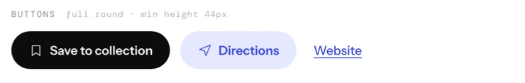
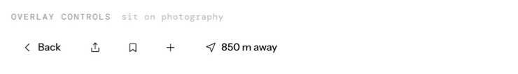
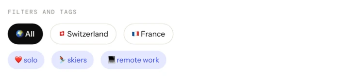
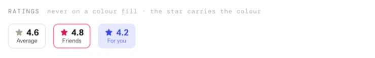
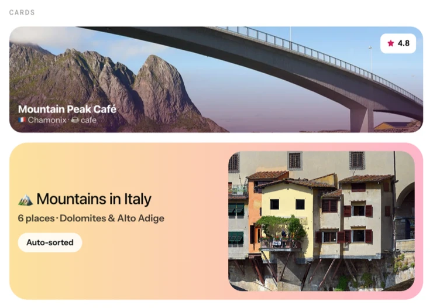
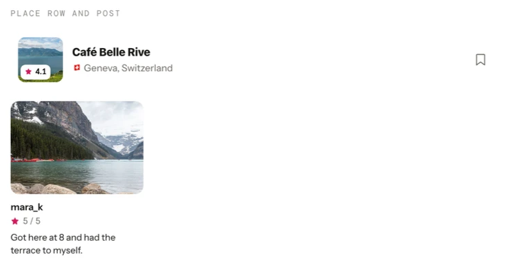

# Components

Every component on the boards, in the order you'd build them. Each one has its crops, the file that builds it today, the spec, and what that file has to change to match. Values in the specs refer to [tokens.md](tokens.md): "surface" is white, "hairline" is the 1px warm outline, "muted" is the grey text colour, and so on.

Sizes come from the screens (1px ≈ 1pt). A few components only appear on the component sheet, which draws things 10–30% larger. Their sizes here are scaled down to match the screens, and say so.

## At a glance

| Component | Built by today | Work to match |
| --------- | -------------- | ------------- |
| [Buttons](#buttons) | `ui/button.tsx` | Add an icon, make it taller, bigger label |
| [Icon buttons](#icon-buttons) | (nothing) | New primitive |
| [Overlay controls](#overlay-controls) | inline in `place-details.tsx` | New primitive, icons instead of words |
| [Filter pills](#filter-pills) | `ui/filter-pill.tsx` | White with hairline instead of grey, 14pt |
| [Tags](#tags) | `ui/tag.tsx` | A little taller, 14pt |
| [Chips](#chips) | (nothing) | New primitive |
| [Rating badges](#rating-badges) | `ui/rating-badge.tsx` | White Average with hairline, smaller radius |
| [Corner rating](#corner-rating) | `ui/corner-rating.tsx` | Smaller radius, add a large size |
| [Search field](#search-field) | `ui/search-field.tsx`, `search-bar.tsx`, `search-filter-bar.tsx` | White with hairline and icon, then one field |
| [Photo card](#photo-card) and [feed post](#feed-post) | `place-card.tsx`, `media-strip.tsx`, `city-tile.tsx` | Move the text onto the photo |
| [Collection card](#collection-card) | `ui/collection-tile.tsx` | New washes, rounder, bigger type and photo, status chip |
| [Place row](#place-row) | `saved-place-row.tsx` | Restyle |
| [Post tile](#post-tile) | inline in `place-details.tsx` | Extract and restyle |
| [Avatar stack](#avatar-stack) | `avatar.tsx` (one avatar) | New |
| [Section heading](#section-heading) | inline in each screen | Optional primitive |
| [Headers](#headers) | each screen | Per screen |
| [Tab bar](#tab-bar) | `src/app/(tabs)/_layout.tsx` | Outline and filled icons, ink tint |
| [Toggle row](#toggle-row) | `settings-row.tsx` with `Switch` | Ink switch |
| [Toast](#toast) | (nothing) | New |

`ui/` means `src/components/ui/`. Other files are in `src/components/`.

---

## Buttons

**Crops:** [components/buttons.png](reference/components/buttons.png), [details/place-details-actions@2x.png](reference/details/place-details-actions@2x.png)
**Built by:** `ui/button.tsx` (primary, secondary, link)

- Fully round. The main action is 48pt tall, and nothing is under 44 ("min height 44px" on the board).
- Label 16/600, centred. Optional 18pt line icon 8pt before the label: bookmark on "Save to collection", navigation on "Directions".
- **Primary:** ink fill, white label and icon. One per screen. As the screen's main action it stretches across the row. On place details it fills everything except the + circle and a 10pt gap.
- **Secondary:** ice fill, periwinkle text label and icon.
- **Link:** no fill or padding, periwinkle text 14/500, underlined, optional leading icon in the same colour (globe for Website, navigation for Directions). Links in a row are separated by a muted "·" with 8pt either side.
- Pressed: about 70% opacity. Disabled: 40%, which `button.tsx` already does.

**To match:** `button.tsx` has no icon slot and comes out about 36pt tall (13pt label, 10pt vertical padding). Add an `icon` prop, a minimum height of 48 (never under 44), and the 16pt `type.button` label. Link text is 14.

## Icon buttons

**Crops:** [details/feed-header@2x.png](reference/details/feed-header@2x.png) (header), [details/place-details-actions@2x.png](reference/details/place-details-actions@2x.png) (+ circle), [details/place-details-hero@2x.png](reference/details/place-details-hero@2x.png) (on a photo)
**Built by:** nothing yet. Add `IconButton` to `ui/` with three variants:

| Variant | Size | Fill | Icon | Where |
| ------- | ---- | ---- | ---- | ----- |
| `surface` | 40 | white | ink, 20 | Feed header: search, saved |
| `ice` | 50 | ice | periwinkle text, 20 | The + beside Save to collection |
| `overlay` | 32 | overlay (94% white) | ink, 16 | On photos: share, bookmark, add |

- Always a circle, with no border and no shadow.
- No visible text, so each one needs an `accessibilityLabel`. Give the 32 and 40 sizes `hitSlop` to reach 44.
- A saved bookmark keeps theme.ts's saved look: a butter circle with an ink icon. The boards don't draw it.

## Overlay controls

**Crops:** [components/overlay-controls.png](reference/components/overlay-controls.png) (drawn on white; on a photo they're 94% white), [details/place-details-hero@2x.png](reference/details/place-details-hero@2x.png)
**Built by:** inline in `place-details.tsx`, as words ("Back", "Share", "Save", "Post") on plain buttons.

- **Pill:** 32pt tall, overlay fill, 12pt horizontal padding (10 on the icon side), 14/500 ink label, 16pt icon with 6pt before the text. Two in the reference: "‹ Back" and "➤ 850 m away". The distance pill is information, not a button.
- **Circles:** `IconButton` `overlay` for share, bookmark and add.
- **Placement on the hero:** Back at the top-left and the circles at the top-right, 8pt apart. Both sit 18pt in from the sides and 8pt below the safe-area top. The distance pill is at the bottom-left, 16pt above the photo's bottom edge.

**To match:** a new `OverlayPill` in `ui/`, plus `IconButton`. Swap the words for icons: share, bookmark, plus.

## Filter pills

**Crops:** [components/filters-and-tags.png](reference/components/filters-and-tags.png) (top row), [details/saved-header@2x.png](reference/details/saved-header@2x.png), [details/feed-header@2x.png](reference/details/feed-header@2x.png)
**Built by:** `ui/filter-pill.tsx`

- 34pt tall, fully round, 14pt horizontal padding. Label 14/500 ink, with an emoji or flag first and a space after it.
- **Off:** surface with a hairline. **On:** ink fill, white 14/600 label, no hairline. One on at a time.
- The first pill is "🌍 All". The rest are countries with flags (Saved) or categories with emoji (Feed: "☕ Coffee", "⛷️ Slopes", "🥾 Hikes").
- A row is a horizontal `ScrollView` with 6–8pt gaps. It starts at the page margin and scrolls off the right edge of the screen: use content padding, not a margin that clips it. `saved.tsx` already does this.

**To match:** off is the grey `fill` with no border at 13pt. It should be surface with a hairline at 14pt. Emoji already come from `getTagEmoji`, and country flags from `country-flags.ts`.

## Tags

**Crops:** [components/filters-and-tags.png](reference/components/filters-and-tags.png) (bottom row), [details/place-details-body@2x.png](reference/details/place-details-body@2x.png)
**Built by:** `ui/tag.tsx`

- Ice fill, no border, periwinkle text 14/500, emoji first: "❤️ solo", "⛷️ skiers", "💻 remote work".
- **Medium** (full pages): 34pt tall, 14pt horizontal padding. **Small** (inside cards and rows): 26pt tall, 10pt padding, 12–13pt text.
- They wrap onto new lines with 6–8pt gaps.
- Tags describe a place. They aren't buttons, so don't make them look pressable.

**To match:** medium is about 30pt with 13pt text. Make it 34pt with 14pt text.

## Chips

Three small pills that label something:

| Chip | Where | Look |
| ---- | ----- | ---- |
| Status | On a collection card: "Auto-sorted", "Shared" | Chip-on-wash white (90%), 32pt, 14pt padding, 13/600 ink |
| Verified | After a place name, on its last line | Surface with a hairline, 18pt, 8pt padding, 11/500 ink, 6–8pt after the name, centred on the text line |
| User | Top-left of a photo post | Overlay white, 30pt. A 20pt avatar circle 4pt from the left, 6pt gap, 13/600 username, 12pt right padding |

**Crops:** [details/saved-collection-card@2x.png](reference/details/saved-collection-card@2x.png), [details/place-details-header@2x.png](reference/details/place-details-header@2x.png), [details/feed-post@2x.png](reference/details/feed-post@2x.png)
**Built by:** nothing yet. Add `Chip` to `ui/` with these three variants. The user chip can use `Avatar` for its circle.

## Rating badges

**Crops:** [components/ratings.png](reference/components/ratings.png), [details/place-details-header@2x.png](reference/details/place-details-header@2x.png)
**Built by:** `ui/rating-badge.tsx`

- 38pt tall, at least 50pt wide, padding 8 × 6, radius 8: a rounded rectangle, not a pill.
- Centred. Line 1 is the star (12pt) and number (14/700). Line 2 is the label (10/500).
- Colours per variant are in [tokens.md](tokens.md#ratings). The badges stay different shapes on purpose, so they can be told apart without reading: Average is plain, Friends has the pink outline, For you is filled ice.
- Next to a place title they sit right-aligned and top-aligned with it, 6pt apart, with short labels "Avg", "Friends", "You". Where there's room, as on the sheet, the labels are "Average", "Friends", "For you".
- Only show the badges there's data for, always in that order.

**To match:** change the Average fill from grey to surface with a hairline, the radius from 13 to 8, and the Average star colour. Add a long-label option.

## Corner rating

**Crops:** [components/cards.png](reference/components/cards.png) (top right), [components/place-row-and-post.png](reference/components/place-row-and-post.png) (on the thumbnail), [details/feed-post@2x.png](reference/details/feed-post@2x.png)
**Built by:** `ui/corner-rating.tsx`

- Overlay white, radius 8, rose text star and ink number 13/700, 4pt apart. Always the average rating, with no label.
- **Large** (photo cards): 29pt tall, 10pt horizontal padding, 14pt in from the top-right corner.
- **Small** (thumbnails): 19pt tall, 6pt padding, 11pt text, 4pt in from the bottom-left.

**To match:** radius 13 makes it a pill at this size, so use 8. Add a `size` prop. The large size doesn't exist yet.

## Search field

**Crops:** [components/field-toggle-feedback.png](reference/components/field-toggle-feedback.png) (top), [details/saved-header@2x.png](reference/details/saved-header@2x.png)
**Built by:** `ui/search-field.tsx`. `search-bar.tsx` and `search-filter-bar.tsx` draw their own fields.

- 46pt tall, fully round, surface with a hairline, full width inside the page margins.
- Search icon 18pt, muted, 16pt from the left, with 10pt before the text.
- Text and placeholder are 15pt. The placeholder is muted and says what you're searching: "Search your places", "Search places and people".

**To match:** it's grey with no border and no icon today. Make it surface with a hairline and an icon, then build `search-bar.tsx` and `search-filter-bar.tsx` on it so there's one search field. The ▽ filter button in `search-filter-bar.tsx` has no counterpart in the reference, which filters with pills instead (see the open decisions in [implementation-plan.md](implementation-plan.md)).

## Photo card

**Crops:** [components/cards.png](reference/components/cards.png) (top), [details/feed-post@2x.png](reference/details/feed-post@2x.png)
**Built by:** `place-card.tsx` (Feed), `city-tile.tsx` (Explore), `media-strip.tsx` (the swipeable photos)

- Full content width, radius 22, the photo fills the card. On the Feed it's 353 × 345, nearly square. The sheet also shows a wide banner, about 4:1.
- A scrim over the bottom ~45%, from transparent to `scrim`.
- Bottom-left, 14pt in: the title (18/700 white), then a meta line (13pt, white at 85%) of the flag and place, the category emoji and word, and social proof, joined by " · ". For example: "🇮🇹 Veneto · 🔭 viewpoint · 2 friends here".
- Top-left: the user chip, for who posted. Top-right: a large corner rating. Both 14pt in.
- Tapping the photo opens the place.

## Feed post

**Crops:** [details/feed-post@2x.png](reference/details/feed-post@2x.png)
**Built by:** `place-card.tsx`, with `like-button.tsx`, `comment-button.tsx` and `bookmark-button.tsx`

A photo card, then:

- **Action row**, 16pt below the photo: "♡ 24", "💬 6", "🔖 Save". 18pt muted line icons, each followed 6pt later by 14pt muted text, with 20pt between the groups.
- **Caption**, 12pt below: the username in 15/700, then the text in 15/400. Two lines at most, with an ellipsis.
- **"See more"**, muted 14pt, about 20pt below.
- 24pt to the next post.

**To match:** `place-card.tsx` puts the name and location above the photo and the ratings and chips below the actions. The reference moves the name, location, poster and rating onto the photo, has no tag chips, and shows one caption. Its photo is close to square, where `MediaStrip` uses a fixed 4:5. Swiping between photos can stay, even though the reference only shows one.

## Collection card

**Crops:** [components/cards.png](reference/components/cards.png) (bottom), [details/saved-collection-card@2x.png](reference/details/saved-collection-card@2x.png)
**Built by:** `ui/collection-tile.tsx` (the look), `collection-card.tsx` (which collection's data goes on it)

- Full width, radius 32, an opaque horizontal wash from [tokens.md](tokens.md#collection-washes), cycled by index.
- **Left:** a text block, 16pt in from the edge and vertically centred:
  - emoji and name, 24/28 Medium (500) ink, wrapping to 2 lines
  - 6pt gap, then the details in 15/20 SemiBold (600), ink at 75% so the wash tints it: "6 places · Dolomites & Alto Adige"
  - 14pt gap, then the status chip ("Auto-sorted" or "Shared"), if there is one
- **Right:** the photo, about 43% of the card's width, 15pt in from the top, right and bottom, radius 22.
- The height grows with the text: 233pt and 185pt in the reference, never under about 180. Cards stack 12pt apart.
- The name is a lighter weight than the details on purpose. `collection-tile.tsx` explains why, so keep it.

**To match:** radius 26 → 32. Name 21/26 → 24/28. Details 13/18 → 15/20 in 75% ink. The photo is 100pt wide with radius 18, and should be about 43% of the width with radius 22. Add the status chip, and take the gradients from the new tokens. The `compact` variant has no counterpart in the reference. Keep it, restyled with the same tokens.

## Place row

**Crops:** [components/place-row-and-post.png](reference/components/place-row-and-post.png) (top)
**Built by:** `saved-place-row.tsx`. `search-result-card.tsx` and `map-place-preview.tsx` are rows too and should match it.

Sizes scaled down from the sheet:

- A 60pt square thumbnail with radius 12, and a small corner rating at its bottom-left.
- 12pt gap, then the name (16/700 ink, one line with an ellipsis), and 2pt below it a meta line (14pt muted, flag first): "🇨🇭 Geneva, Switzerland".
- A 20pt muted bookmark line icon at the far right, vertically centred. When saved it's filled (theme.ts's `saved`).
- Rows have 12pt of vertical padding and no dividers.

## Post tile

**Crops:** [components/place-row-and-post.png](reference/components/place-row-and-post.png) (bottom), [details/place-details-actions@2x.png](reference/details/place-details-actions@2x.png) (the Posts strip)
**Built by:** inline in `place-details.tsx`, in the Posts strip

- The photo is about 10:7, radius 12.
- 8pt below it, the username in 15/700 ink.
- A rating line: a rose text star, then "5 / 5" in muted 13pt.
- The text in 14/20 ink, up to 3 lines.
- In a horizontal strip, tiles are about 140pt wide (the sheet draws one at about 175), 12pt apart, and the strip runs off the right edge.

**To match:** move the tile into its own component (for Place details and Profile), and swap its image placeholder for the photo.

## Avatar stack

**Crops:** [details/place-details-header@2x.png](reference/details/place-details-header@2x.png)
**Built by:** `avatar.tsx` draws one avatar. The stack is new.

- 28pt circles overlapping by 6pt. Each has a 2pt ring in the canvas colour so they read as separate.
- Initials in 10/700 ink on the avatar tints, in order (rose, butter, lime, ice). The last circle is "+N" on ice. A friend's photo replaces their initials if they have one.
- 12pt after the stack, muted 14pt text: "7 friends saved this".

**To match:** `avatar.tsx` picks a soft colour from `avatarHue` or the user id. Either map that onto the four tints (by id, so a person keeps the same one) or keep the hues. That's an open decision in [implementation-plan.md](implementation-plan.md). The tints are recommended.

## Section heading

**Crops:** [details/saved-header@2x.png](reference/details/saved-header@2x.png), [details/place-details-body@2x.png](reference/details/place-details-body@2x.png)
**Built by:** a `sectionHeading` style in each screen (`saved.tsx`, `place-details.tsx`)

- Plus Jakarta Sans 16/700 ink, sentence case: "Best suited for", "Summary", "Posts", "Collections".
- 12pt down to its content, 24–28pt up to the section before it.
- No "See all" link in the reference.

A `SectionHeading` primitive would stop the screens drifting apart, but it's optional.

## Headers

Every reference screen draws its own header (`headerShown: false`). There are three patterns:

| Pattern | Used on | Anatomy |
| ------- | ------- | ------- |
| Large title | Saved, and other tab roots | Screen title (32/34) at the page margin. 16pt below it the search field, if there is one. 14pt below that, the filter pills |
| Greeting | Feed | On the left a greeting pill: 40pt white pill, 32pt ice avatar circle 4pt in, 8pt gap, "Hey, Ruby" in 15/600, 14pt right padding. On the right, `surface` icon buttons 8pt apart. 24pt below, the headline in the screen title style across two lines. 14pt below that, filter pills |
| Photo | Place details | A full-bleed hero with overlay controls. Content starts 18pt below the photo |

**Crops:** [details/saved-header@2x.png](reference/details/saved-header@2x.png), [details/feed-header@2x.png](reference/details/feed-header@2x.png), [details/place-details-hero@2x.png](reference/details/place-details-hero@2x.png)

## Tab bar

**Crops:** [details/tab-bar@2x.png](reference/details/tab-bar@2x.png), [components/navigation-icons.png](reference/components/navigation-icons.png)
**Built by:** `src/app/(tabs)/_layout.tsx`

- White, with no top line. Five equal-width items.
- A 24pt icon above an 11pt label, 4pt apart.
- **Inactive:** outline glyph and label in muted. **Active:** filled glyph in ink, and the label in ink 600.
- About 70pt tall, plus the home-indicator inset.

**To match:** every tab uses a `.fill` SF Symbol in every state, with the default tint. Use outline glyphs when inactive and `.fill` when active, ink as the active tint and muted as the inactive tint, a white tab bar with no border, and 11pt labels. The reference's tabs (Feed, Search, Map, Profile, Saved) aren't the app's (Profile, Map, Feed, Saved, Explore). Copy the look, not the tab list. Changing the tabs is an open decision.

## Toggle row

**Crops:** [components/field-toggle-feedback.png](reference/components/field-toggle-feedback.png) (middle)
**Built by:** `settings-row.tsx` with React Native's `Switch`. Switches also appear in the Settings screens and `notify-bell.tsx`.

- Title in 16/600 ink, a muted 13pt caption 2pt below it, and the switch on the right, vertically centred.
- On: ink track, white thumb.
- 14–16pt row padding. Rows can sit together on a white surface.

**To match:** every `Switch` uses the platform's green. Add one shared wrapper (for example `ui/switch.tsx`) that sets the "on" track colour to ink and the thumb to white (`Switch` takes `trackColor` and `thumbColor`), and use it everywhere.

## Toast

**Crops:** [components/field-toggle-feedback.png](reference/components/field-toggle-feedback.png) (bottom)
**Built by:** nothing yet.

Sizes scaled down from the sheet:

- Full width inside the page margins, about 52pt tall, radius 12, ink fill.
- An 18pt `check-circle` in white at 70%, 16pt from the left, then 12pt to the text.
- Text in 15/400 white that says what happened and where: "Saved to Europe Trip".
- It floats 12pt above the tab bar (or the bottom inset), appears after an action, and dismisses itself after about 3 seconds. One at a time, no shadow.

**To match:** a new `Toast` primitive and a small provider and hook to show it. The provider has to wrap the app in `src/app/_layout.tsx`, the root layout (Henry's file, per theme.ts).
