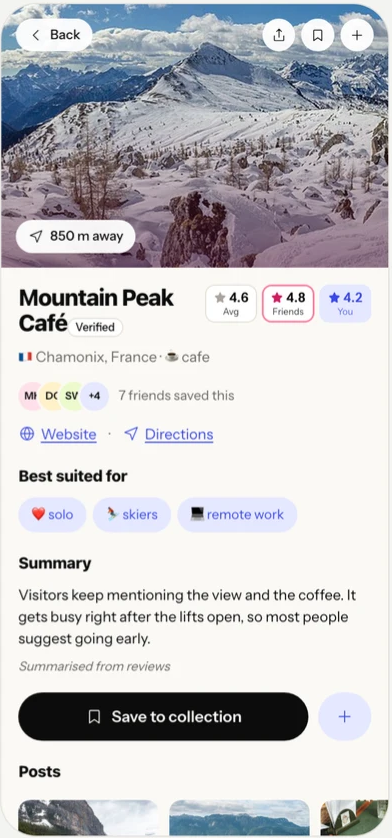
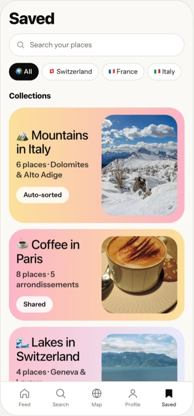
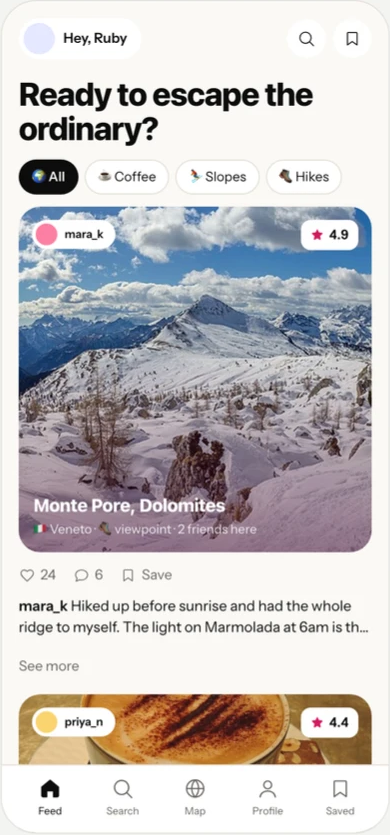

# Screens

The three reference screens, top to bottom, with the gap above each block. The mockups have no status bar or home indicator, so add the safe-area insets as noted. Component names link to [components.md](components.md), and the page plans in [docs/pages/](../pages/README.md) still decide *what* each page shows. This file is about how it looks.

Gaps are measured at 1x (1pt per pixel) and rounded. They run from the bottom of one block to the top of the next block's text or box.

## Place details (`/place/[id]`)

**Crops:** [screens/place-details.png](reference/screens/place-details.png), [hero](reference/details/place-details-hero@2x.png), [header](reference/details/place-details-header@2x.png), [body](reference/details/place-details-body@2x.png), [actions and posts](reference/details/place-details-actions@2x.png)
**Plan:** [04-place-details.md](../pages/04-place-details.md)
**Built by:** `src/app/place/[id].tsx`, which renders `src/components/place-details.tsx`

| Block | Gap above | What's there |
| ----- | --------- | ------------ |
| Hero photo | 0 | Full-bleed, 267pt tall, runs up under the status bar. [Overlay controls](components.md#overlay-controls): Back pill at the top-left, share / bookmark / add circles at the top-right, distance pill at the bottom-left |
| Title row | 18 | The title (22/25, 800, up to 2 lines), with the [Verified chip](components.md#chips) after its last word. The [rating badges](components.md#rating-badges) sit right-aligned and top-aligned with the title, 6pt apart. The title wraps before it reaches them (about 170pt wide on a 390pt screen) |
| Meta line | 12 | Flag, "Chamonix, France · ☕ cafe" in 14pt muted |
| Friends | 18 | [Avatar stack](components.md#avatar-stack), then "7 friends saved this" |
| Links | 16 | "🌐 Website · ➤ Directions" as [link buttons](components.md#buttons) |
| Best suited for | 28 | [Section heading](components.md#section-heading), then medium [tags](components.md#tags) 12pt below |
| Summary | 24 | Heading. 12pt below, the paragraph in 15/22 ink. 8pt below that, "Summarised from reviews" in 13pt muted italic |
| Actions | 20 | Primary "Save to collection" with a bookmark icon, stretching across, then 10pt and the 50pt ice + circle |
| Posts | 24 | Heading, then a strip of [post tiles](components.md#post-tile) 12pt below, running off the right edge |

- The Save to collection row scrolls with the content. It isn't pinned to the bottom.
- Content uses the 18pt page margins. Only the hero and the posts strip go edge to edge.

**Today:** `place-details.tsx` already has these blocks in this order. To match it still needs the photo (there's a placeholder now), icons instead of words on the overlay buttons, the Verified chip, the avatar stack, icons on the links, and the Save to collection row. The code says "Summarised from posts" where the reference says "reviews". Use whichever is true of the data.

## Saved (`/saved`)

**Crops:** [screens/saved-collections.png](reference/screens/saved-collections.png), [header](reference/details/saved-header@2x.png), [collection card](reference/details/saved-collection-card@2x.png), [tab bar](reference/details/tab-bar@2x.png)
**Plan:** [05-saved-collections.md](../pages/05-saved-collections.md)
**Built by:** `src/app/(tabs)/saved.tsx`

| Block | Gap above | What's there |
| ----- | --------- | ------------ |
| Title | 16 below the top inset | "Saved" as a [large title](components.md#headers) |
| Search field | 16 | [Search field](components.md#search-field), "Search your places" |
| Filter pills | 14 | [Filter pills](components.md#filter-pills): "🌍 All", then one per country the user has saved, flag first |
| Collections | 24 | [Section heading](components.md#section-heading) |
| Collection cards | 12 | [Collection cards](components.md#collection-card), 12pt apart, the washes cycling |
| Tab bar | | [Tab bar](components.md#tab-bar), with Saved active |

**Today:** `saved.tsx` has the title, the country pills, Collections and the cards, then a "Saved places" section of rows. It has no search field. The reference doesn't show "Saved places", probably because it's below the fold. Keep it, using [place rows](components.md#place-row).

## Feed (`/`)

**Crops:** [screens/feed.png](reference/screens/feed.png), [header](reference/details/feed-header@2x.png), [post](reference/details/feed-post@2x.png)
**Plan:** [02-feed.md](../pages/02-feed.md)
**Built by:** `src/app/(tabs)/index.tsx`, with `src/components/place-card.tsx`

| Block | Gap above | What's there |
| ----- | --------- | ------------ |
| Greeting header | 16 below the top inset | [Greeting pill](components.md#headers) with the user's avatar and first name ("Hey, Ruby"). Search and saved [icon buttons](components.md#icon-buttons) on the right |
| Headline | 24 | "Ready to escape the ordinary?" in the screen title style, two lines, about 300pt wide |
| Category pills | 14 | [Filter pills](components.md#filter-pills): "🌍 All", "☕ Coffee", "⛷️ Slopes", "🥾 Hikes" |
| Posts | 14 | [Feed posts](components.md#feed-post), 24pt apart |
| Tab bar | | Feed active |

**Today:** the Feed has the search bar with its ▽ filter sheet at the top, and a "+" for a new post, above a list of `PlaceCard`s. In the reference, search is an icon button, categories are pills, and there's no "+". Upload still needs a way in (see the open decisions in [implementation-plan.md](implementation-plan.md)). The reference doesn't say where the header's bookmark goes, and Saved is also a tab.

## Screens without a reference

Build these from the closest reference pattern. These are suggestions, not part of the boards. Say in your PR when you've extended the style, so the team can look.

| Screen | Start from |
| ------ | ---------- |
| Collection list (`/collection/[id]`) | Large title (the collection's emoji and name) with its details line in muted below, then [place rows](components.md#place-row) |
| City (`/city/[id]`) | A photo header like Place details (city photo plus a Back pill), then filter pills and [photo cards](components.md#photo-card) or place rows. Restyle `ViewToggle` to match the filter pills |
| Explore | Large title, search field, then city tiles as photo cards: radius 22, city name on the scrim |
| Map | Full-bleed map. A search field floats at the top: surface with a hairline, no shadow. The pin preview is a place row on a white surface with radius 22 |
| Profile | Large title or photo header, collections as [collection cards](components.md#collection-card) (the `compact` variant when there are many), posts as [post tiles](components.md#post-tile) |
| Upload (modal) | Large title, fields that look like the search field (white, hairline, 46pt, round; a multi-line field uses radius 22 because a pill can't hold a paragraph), tags as tag pills, primary button at the bottom |
| Settings | Large title, [toggle rows](components.md#toggle-row) and setting rows grouped on white surfaces (radius 22) on the canvas. Option pills look like filter pills |
| Log in, Create account | Canvas, large title, fields that look like the search field, a full-width primary button, a link button for the other path |
