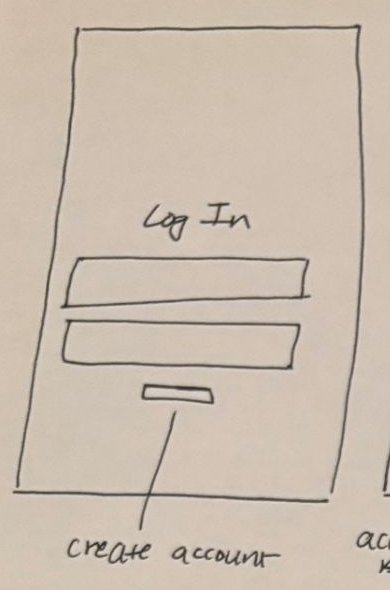

# 1. Log in (and Create account)

| | |
| - | - |
| **Route** | `/login` and `/create-account` |
| **Files** | `src/app/login.tsx`, `src/app/create-account.tsx` |
| **Navigator** | Root stack, in the signed-out group |
| **Status** | Log in signs in with Supabase. Create account and the login gate aren't connected yet. |

## Where it sits in navigation

- **Reached from:** opening the app while signed out, or **Log out** on Profile.
- **Goes to:** Create account (link), and the Feed after signing in.
- Signing in doesn't need a `router.push`. Setting the session user flips the `Stack.Protected` guard, and the router moves to the tabs on its own (see [README](README.md#login-gate)).
- No back button. When you're signed out, this is the first screen.

## Sketch → what we build

| Sketch | Build |
| ------ | ----- |
| "Log In" title | App name and a "Log in" title |
| First box | Email (`AuthInput` with `isEmail`, already there). Supabase signs in with an email, not a username. |
| Second box | Password (`AuthInput` with `isPassword`, already there) |
| Small button labelled "create account" | Link to `/create-account`, already there. Keep the **Log in** button above it. |
| *(not in sketch)* | **Demo users** section, described below |

### Demo users

Under the form, add a "Demo: continue as" heading and one button per mock user, showing their avatar, name, and a one-line description. Tapping one signs in as that user, so there's nothing to type during a demo. With Supabase, each demo user has to be a real account (see the open questions).

Suggested demo users. Give each one different data so switching users changes what you see:

- A solo backpacker who's in a different country from their home country, with lots of reviews.
- A skier with a "Ski trips" collection.
- A brand-new user with no reviews or collections, to show the empty states.

## Behaviour

- **Log in (done):** the existing checks stay. Then `signIn(email, password)` from `useUser()` signs in with Supabase, and Supabase's error message shows under the button if it fails. The button is disabled while the request runs.
- **Create account:** the existing checks stay (all fields filled, passwords match). Then call `signUp({ email, password, name, username })` from `useUser()`. Check that the username isn't already taken first, because a taken one fails with Supabase's vague "Database error saving new user". If "Confirm email" is on in Supabase, tell the person to check their email.
- **Log out** (on Profile): `signOut()` clears the user, and the guard sends you back here.

## Data

- `User` (`src/types/user.ts`), `LoginFields`, and `CreateAccountFields` already exist.
- `src/hooks/use-user.tsx` holds `UserContextProvider` and `useUser()`, which returns `{ user, session, isLoading, signIn, signUp, signOut, refreshUser }`. The root layout is already wrapped in the provider.
- Supabase Auth keeps the email and password. The name and username live in the `profiles` table, which a trigger fills in at sign-up (`supabase/migrations/20261101000000_create_profiles.sql`).
- Sign-in survives an app reload, because Supabase saves the session on the device.

## States

- Signing in: show a spinner and disable the buttons.
- Wrong email or password, or a username that's already taken: show the message under the button, the same way the current `message` text works.

## Open questions

- Demo users: make them real Supabase accounts whose emails and passwords the demo buttons send, or drop the demo buttons?
- Should the demo buttons be hidden in a real release build?
