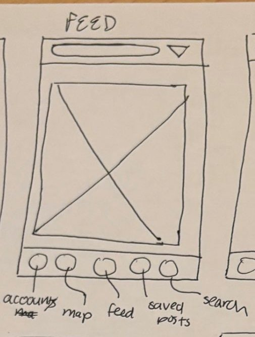

# 2. Feed

| | |
| - | - |
| **Route** | `/` |
| **File** | `src/app/(tabs)/index.tsx` |
| **Navigator** | Tab: "Feed", the middle tab, and where the app opens |
| **Status** | Placeholder |

## Where it sits in navigation

- **Reached from:** the tab bar, or right after signing in.
- **Goes to:**
  - Place details: tap a card (`router.push('/place/' + id)`).
  - Save to collection sheet: tap the bookmark.
  - Upload modal: tap the `+` in the header.

## Sketch → what we build

| Sketch | Build |
| ------ | ----- |
| Search pill and ▽ at the top | `SearchFilterBar`. Typing filters places by name or city, and ▽ opens filters for place type and suited for. Shared with Map and Saved. |
| Big box with an X | One **place card** per place, full width, in a vertical `FlatList`, like an Instagram feed |
| Five circles at the bottom | The tab bar: account, map, feed, saved, search |

### Place card, top to bottom

1. **Header row:** place name, a verified check, and "City, Country".
2. **Media:** the cover image followed by the place's `media`, which you can swipe sideways (`MediaStrip`), with page dots. Use a square or 4:5 shape so cards line up.
3. **Action row:** `BookmarkButton`, plus share later.
4. **Info:** `RatingStars` with the average rating, the friends' rating if there is one, the place type, and suited-for chips.
5. **Text:** the description cut to 2 lines, or the newest friend review.

Tapping the name or the image opens Place details.

## Data

- `getPlaces(filters)` returns `Place[]` from `src/services/places.ts`.
- `getSavedCollectionIds(placeId)` decides whether each bookmark is filled. Alternatively, `getPlaces` can return a `isSaved` flag for the signed-in user.
- Order: mock order for the demo. Closest first (`proximity`) or newest can come later.

## Components

| Component | Status |
| --------- | ------ |
| `FeedItem` | Rewrite as `PlaceCard`. It uses web HTML and the `Post` type, and needs to take a `Place`. |
| `MediaPost` | Swap Previous/Next buttons for swiping. This becomes `MediaStrip`. |
| `SearchBar` | Reuse inside `SearchFilterBar` |
| `SearchFilterBar`, `BookmarkButton`, `RatingStars` | New, shared ([README](README.md#shared-pieces)) |

## States

- **Loading:** a spinner or gray placeholder cards.
- **Empty:** "No places match your search" with a "Clear filters" button.
- **Error:** a message and a "Try again" button.
- **Pull to refresh:** `FlatList`'s `refreshing` and `onRefresh` props.

## Performance

Long image lists are where a phone feels slow:

- Use `FlatList` with a `keyExtractor`, not `ScrollView` with `.map`.
- Use `expo-image` (already installed). It caches images.
- Give cards a fixed image height so the list doesn't jump while images load.

## Open questions

- **Places or posts?** The plan says the feed shows *places*. But `FeedItem` and `Post` were written for *people's posts*, with a username, likes, and comments, like Instagram. Pick one:
  - Recommended for now: place cards that show the newest friend review on the card.
  - Or each card is one person's review of a place.
- Where does the Upload `+` go? The plan puts it in the header next to search. The sketch doesn't show it.
