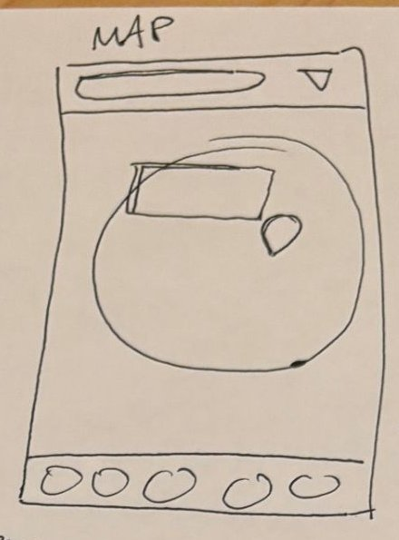

# 3. Map

| | |
| - | - |
| **Route** | `/map` |
| **File** | `src/app/(tabs)/map.tsx` |
| **Navigator** | Tab: "Map" |
| **Status** | Placeholder |

## Where it sits in navigation

- **Reached from:** the tab bar.
- **Goes to:** tap a pin to show a popup card *on this page* (not a new route). The card's "View details" button opens Place details (`router.push('/place/' + id)`).

## Sketch → what we build

| Sketch | Build |
| ------ | ----- |
| Search pill and ▽ at the top | `SearchFilterBar`, the same one as the Feed. Filters hide pins that don't match. Searching a city moves the map to it. |
| Big circle | Full-screen map that starts zoomed all the way out, so you see the globe |
| Teardrop | One pin per place, placed at its `latitude` and `longitude` |
| Rectangle next to the pin | **Preview card:** small cover image, name, "City, Country", `RatingStars`, and a "View details" button. Tap the map or an ✕ to close it. |

The sketch draws the card next to the pin. A card along the bottom of the map is easier and looks the same on iOS and Android. Either is fine.

## Map library

The recommended Expo module is **`expo-maps`**. It uses Apple Maps on iOS (`AppleMaps.View`) and Google Maps on Android (`GoogleMaps.View`). From the SDK 57 docs:

- **It doesn't work in Expo Go.** You need a development build: `npx expo run:ios` or `npx expo run:android` locally, or `eas build --profile development` in the cloud. Anyone testing in Expo Go will see the fallback described below.
- **It's in alpha,** so expect breaking changes when we update the SDK.
- **No web support.** On web, show a list of places instead.
- **Android needs a Google Maps API key** in `app.json` under `android.config.googleMaps.apiKey`.
- **Tapping a pin on iOS** (`onMarkerClick`) needs iOS 18 or newer, so use an iOS 18+ simulator.
- **Globe:** the docs don't promise a 3D globe when you zoom out. On iOS, `properties.elevation: REALISTIC` gives a 3D map.

**First step:** build a small test map on iOS and Android, zoom all the way out, and check whether it looks enough like a globe. If a real globe on every platform is a must, `@rnmapbox/maps` has a globe view, but it needs a Mapbox account and token. Decide after the test.

Fallback: when the native map isn't available (web or Expo Go), show a simple list of places that links to Place details, so the tab never crashes.

## Data

- `getPlaces(filters)` provides the pins.
- `Place` needs `latitude` and `longitude`, which is a type change in the [README](README.md#type-changes). Add coordinates to all the mock places.
- The `Map` type in root `types.ts` (`geotag`, `isPinned`, `previewImage`) isn't needed if pins come from `Place`.

## Components

| Component | Status |
| --------- | ------ |
| `MapPin` | Rewrite as `MapPlacePreview`, the popup card. Pins themselves are data passed to the map's `markers` prop, not components. The current version uses web HTML. |
| `SearchFilterBar`, `RatingStars` | Shared |

## States

- **Loading:** show the map right away and add pins when they arrive.
- **No matches:** a small "No places match" banner over the map.
- **Map not available:** the fallback list.

## Open questions

- Should we show where you are? That needs location permission (`expo-maps` has `useLocationPermissions`). It isn't needed for v1.
- Should nearby pins group into one bubble when there are many places? Later.
