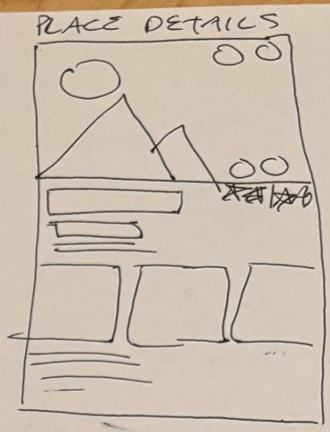

# 4. Place details

| | |
| - | - |
| **Route** | `/place/[id]`, for example `/place/place_001` |
| **Files** | `src/app/place/[id].tsx` (exists), `src/components/place-details.tsx` (partly built) |
| **Navigator** | Root stack, pushed on top of the tabs. The tab bar is hidden and there's a back button. |
| **Status** | The route works with `mockPlace`. The component shows raw fields. |

## Where it sits in navigation

- **Reached from:** a Feed card, the Map popup, a Collection list row, a review on Profile, or a Search result.
- **Goes to:**
  - Save to collection sheet: the bookmark button.
  - Upload modal with the place filled in: "Write a review" (`/upload?placeId=...`).
  - The phone's maps app: directions.
  - The place's website: `expo-web-browser`, already installed.
- **Header:** make the header transparent so the cover image reaches the top of the screen with the back button on top of it. Set the header title to the place's name.

## Sketch → what we build

| Sketch | Build |
| ------ | ----- |
| Big image (mountain and sun) | `coverImage`, full width, about 40% of the screen height |
| Two circles, top right of the image | **Share** and **Bookmark** (`BookmarkButton`, filled if the place is in any collection, opens the save sheet) |
| Two circles, bottom right of the image | **Directions** (opens `directions` in maps) and **Website** (opens `website`, hidden when there isn't one). This is our reading of the sketch, so change it if you meant something else. |
| Crossed-out stars below the image | The rating moves down next to the title instead |
| Long bar | **Name** and a verified badge |
| Shorter bars | "City, Country · place type". Then the `RatingStars` average and the friends' rating ("Friends: 4.8"). Then suited-for chips (`ChipList`). |
| Three boxes running off both edges | **Media strip:** every photo and video for the place (`place.media` plus the photos in its reviews) in a horizontal `FlatList`. The next item peeks in from the edge so it's clear you can scroll. Later, tapping one opens it full screen. |
| Lines at the bottom | **Details:** description, address (tap for directions), website. Then **Reviews** as `ReviewCard`s, newest first, and a **Write a review** button. |

## Data

- `getPlace(id)` from `src/services/places.ts` replaces the current `id === mockPlace.id` check.
- `getReviewsForPlace(id)` comes from `src/services/reviews.ts`. `Place.reviews` can be dropped if reviews are always fetched separately.
- `getSavedCollectionIds(id)` sets the bookmark state.
- `Place.media` is a type change in the [README](README.md#type-changes).

## Components

| Component | Status |
| --------- | ------ |
| `PlaceDetails` | Finish it following the table above. Swap the remote star image for `RatingStars`, and swap the local-only bookmark for `BookmarkButton`. |
| `MediaPost` | Replace with a horizontal `MediaStrip` |
| `BookmarkButton`, `RatingStars`, `ReviewCard`, `ChipList` | Shared, and `ReviewCard` is reused on Profile |

**Layout:** the page is taller than the screen, so wrap it in a `ScrollView`. A horizontal media list inside it works fine. Render reviews with `.map()` rather than a `FlatList`, because a vertical list inside a vertical `ScrollView` causes a warning.

## States

- **Loading:** a gray image area and placeholder lines.
- **Not found:** already handled. Add a "Go back" button.
- **No media:** "No photos yet" with an "Add one" button that opens Upload.
- **No reviews:** "Be the first to review" with the Write a review button.

## Open questions

- Should tapping the bookmark save straight to "All saved" and *then* offer collections, or always open the sheet? The plan always opens the sheet (see [05](05-saved-collections.md#save-to-collection-sheet)).
- Can you tap a reviewer to open their profile? That needs a `/user/[id]` page (see [08](08-profile.md#open-questions)).
