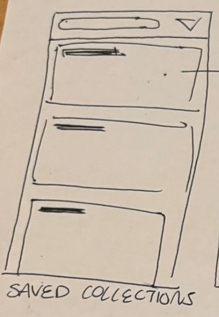

# 5. Saved collections

| | |
| - | - |
| **Route** | `/saved` |
| **File** | `src/app/(tabs)/saved.tsx` (new) |
| **Navigator** | Tab: "Saved", called "saved posts" in the sketch. SF Symbol `bookmark.fill`, Material `bookmark`. |
| **Status** | New. Add the file and a `Tabs.Screen` in `src/app/(tabs)/_layout.tsx`. |

## Where it sits in navigation

- **Reached from:** the tab bar.
- **Goes to:**
  - Collection list: tap a card (`router.push('/collection/' + id)`). This is the arrow in the sketch.
  - New collection: the `+` in the header.

## Sketch → what we build

| Sketch | Build |
| ------ | ----- |
| Search pill and ▽ at the top | `SearchFilterBar`. Typing filters collections by name, and ▽ sorts them (recent, name, most items). |
| Large cards, each with a title line | **Collection card:** the cover image fills the card, the name sits in the top-left, and the count ("12 places") is under it. Vertical `FlatList`. |
| Arrow from a card to the next screen | Tapping a card opens [Collection list](06-collection-list.md) |

- The **first card is always "All saved".** It holds everything you've bookmarked, whichever group it's in, and it can't be renamed or deleted.
- The cover image is the collection's `coverImage`, or the image of its first item if there isn't one.
- **New collection:** the `+` asks for a name and creates an empty collection.
- **Rename and delete:** long-press a card. Can come later.

## Save to collection sheet

This sheet isn't in the sketch, but it's how things get *into* collections, so it's planned here.

| | |
| - | - |
| **Route** | `/save-to-collection?placeId=...`, file `src/app/save-to-collection.tsx` |
| **Navigator** | Root stack, shown as a sheet that slides up |
| **Opened by** | `BookmarkButton` on a Feed card, Place details, or a Collection list row |

What's on it:

- A list of the user's collections, each with a checkmark if this place is already in it. Tapping a row adds or removes the place.
- A "New collection" row at the bottom. Type a name, and the place is added to the new collection.
- Saving to any collection also adds the place to "All saved". Removing it from every collection removes the bookmark.

## Data

- `Collection` and `CollectionItem` are new types (see the [README](README.md#type-changes)).
- From `src/services/collections.ts`:
  - `getCollections(userId)`
  - `createCollection(name)`
  - `addToCollection(collectionId, item)` and `removeFromCollection(collectionId, item)`
  - `getSavedCollectionIds(placeId)`
- **Refetch when the tab comes back into view** (`useFocusEffect` from `expo-router`). Otherwise a place bookmarked on the Feed won't show up here until the app reloads.

## Components

- New: `CollectionCard`.
- Shared: `SearchFilterBar`.

## States

- **Empty:** "Nothing saved yet. Tap the bookmark on any place to save it here." Show only the "All saved" card, or none.
- **Loading:** gray placeholder cards.

## Open questions

- Can a collection hold *reviews or posts* as well as places? The user said "places and content". `CollectionItem` supports both, but v1 can save places only.
- Can you share a collection with friends? Later.
