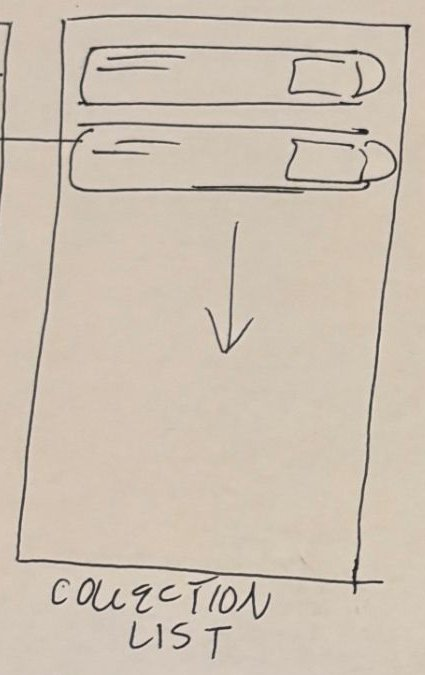

# 6. Collection list

| | |
| - | - |
| **Route** | `/collection/[id]`, for example `/collection/col_ski` |
| **File** | `src/app/collection/[id].tsx` (new). Add a `Stack.Screen` in `src/app/_layout.tsx`. |
| **Navigator** | Root stack, pushed on top of the tabs, with a back button to Saved |
| **Status** | New |

## Where it sits in navigation

- **Reached from:** a card on [Saved collections](05-saved-collections.md).
- **Goes to:** Place details when you tap a row.
- **Header:** the collection's name as the title. A "⋯" button on the right for rename and delete, later.

## Sketch → what we build

| Sketch | Build |
| ------ | ----- |
| Rounded rows with lines on the left | Each row shows the place **name** in bold, then a smaller line: "City, Country · place type · ★ 4.6" |
| Small box on the right of each row | **Thumbnail** of the place's cover image |
| Rounded tab at the far right | **Remove** button: a filled bookmark that takes the place out of *this* collection. This is our reading of the sketch. |
| Down arrow | It scrolls: a vertical `FlatList` |

When you remove a row:

- Show a short "Removed. Undo" message, rather than asking "Are you sure?" first.
- Inside "All saved", removing a place takes it out of every collection.

## Rows for each kind of item

`CollectionItem` can be a place or a review, so the row checks `kind`, the same way `SearchResultCard` does:

- **`place`:** the row described above. Tapping it opens `/place/[placeId]`.
- **`review`:** the reviewer's name, the review's stars, the first line of its text, and the place name. Tapping it opens that place. v1 only needs places, but write the row so adding reviews later is easy.

## Data

- `getCollection(id)` returns the collection with each item's `Place` already attached, so the page doesn't have to fetch every place separately.
- `removeFromCollection(collectionId, item)`.
- Refetch with `useFocusEffect`, because you might un-bookmark a place on Place details and come back here.

## Components

- New: `CollectionItemRow`.
- Similar layout to `SearchResultCard`: it's also a row with an image and text, so copy its structure.

## States

- **Empty:** "No places in this collection yet", with a button to the Feed.
- **Not found:** the collection was deleted. Show a message and a back button.
- **Loading:** gray placeholder rows.

## Open questions

- Should you be able to drag rows to reorder them? Later.
- Should the collection page show a map of its places? This would reuse the Map work. Later.
