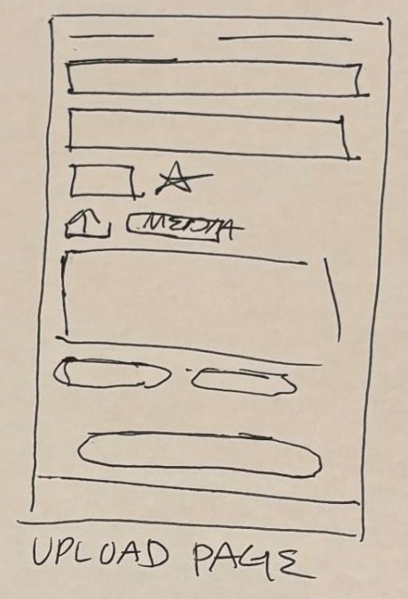

# 7. Upload

| | |
| - | - |
| **Route** | `/upload`, or `/upload?placeId=...` to start with a place filled in |
| **File** | `src/app/upload.tsx` (new). Add `<Stack.Screen name="upload" options={{ presentation: 'modal' }} />` in `src/app/_layout.tsx`. |
| **Navigator** | Root stack, as a **modal** that slides up over everything |
| **Status** | New |

## Where it sits in navigation

- **Opened from:**
  - The `+` in the Feed header (and on Profile).
  - **Write a review** on Place details, which passes `placeId`.
  - "Add one" in the empty media area on Place details.
- **Closes to:** Cancel goes back to where you were (`router.back()`). After posting, close the modal and open the place's page so you can see your post.
- It isn't a tab: the sketch's tab bar already has five tabs, and five is the limit.

## Sketch → what we build, top to bottom

| Sketch | Build |
| ------ | ----- |
| Two short lines at the top | Modal header: **Cancel** on the left and the title "New post" |
| First box | **Place name.** As you type, existing places are suggested. Picking one fills in and locks the location. Typing a name that isn't in the list creates a new place. |
| Second box | **Location** of a new place: address, city, and country |
| Small box and ★ | **Rating:** 5 tappable stars (`RatingStars` in pick mode). Required. |
| Upload icon and "MEDIA" | **Add photos/videos** button. Picked items appear as a horizontal row of thumbnails, each with an ✕ to remove it. |
| Large box | **Review text:** a multi-line text input |
| Two pills | Tag pickers: **Place type** (pick one: cafe, excursion, sport…) and **Suited for** (pick several: solo, adventure, skiers…). These match `Place.placeType` and `Review.suitedFor`. |
| Big pill at the bottom | **Post** button, disabled until a place and a rating are set |

## Behaviour

1. **Check the form**, the same way Login does: show a message under the button when something's missing.
2. **If it's a new place,** call `createPlace()` first.
3. **Then** call `createReview()` with the rating, text, tags, and media.
4. **Close and open the place:** `router.back()`, then `router.push('/place/' + id)`.

- **Cancel with unsaved input:** ask "Discard this post?" first.
- **Keyboard:** use a `ScrollView` with `keyboardShouldPersistTaps="handled"`, like Login, so the keyboard doesn't cover the Post button.

## Picking media

- Use **`expo-image-picker`**. It's a new dependency: install it with `npx expo install expo-image-picker`. Check the SDK 57 docs before using it.
- For the mock, store the picked files' local addresses as `Media.url`. This only lasts until the app reloads, which is fine for a demo. Supabase Storage will upload them later.

## Data

- **`UploadFields`** (new, `src/types/upload-fields.ts`), following the pattern of `LoginFields`:
  - `placeId?`, `placeName`, `address`, `city`, `country`
  - `rating`, `reviewText`, `media: Media[]`
  - `placeType`, `suitedFor: string[]`
- `getPlaces({ search })` for the suggestions, `createPlace()`, and `createReview()`.
- **New places need `latitude` and `longitude`, or they won't appear on the Map.** Decide how to get them (see the open questions).

## Components

| Component | Status |
| --------- | ------ |
| `AuthInput` | Reuse for the text boxes, or rename it to a general `TextField` |
| `RatingStars`, `ChipList`, `MediaStrip` | Shared |
| `PlaceAutocomplete` | New: place name input with suggestions |

## States

- **Posting:** a spinner on the Post button, and everything disabled.
- **Error:** a message, with the form kept as it was.

## Open questions

- **Where do a new place's coordinates come from?** Options:
  - Use the phone's current location (`expo-location`).
  - Look up the typed address.
  - Let the user drop a pin.
- **What does "other content" mean,** besides places, photos, and reviews? Tips, or trips?
- **Do the two lines at the top mean a switch** between "Review a place" and "Add a new place"? The plan handles both in one form, using the place name box.
