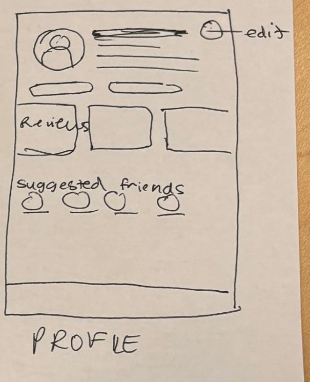

# 8. Profile

| | |
| - | - |
| **Route** | `/profile` |
| **File** | `src/app/(tabs)/profile.tsx` |
| **Navigator** | Tab: "Account", the first tab in the sketch |
| **Status** | Placeholder. `ProfileHeader`, `ProfileInterests`, and `ProfilePosts` already exist. |

## Where it sits in navigation

- **Reached from:** the tab bar.
- **Goes to:**
  - Edit profile modal: the edit button.
  - Place details: tap a review.
  - A friend's profile: tap a suggested friend. This needs a new page (see the open questions).
  - Upload modal: the `+`.
  - Login: **Log out**.
- Delete the temporary "Go to login" link once the login gate works.

## Sketch → what we build

| Sketch | Build |
| ------ | ----- |
| Avatar circle | `profilePicture` (`ProfileHeader`) |
| Bold line and lines beside the avatar | Name, @username, and a short bio |
| Circle top right, labelled "edit" | **Edit** button. `ProfileHeader` already has `isOwnProfile` and `onEditPress`, so move the button to the top right. |
| Two pills | **"Home: 🇺🇸 USA"** and **"Now in: 🇫🇷 France"**, from `homeCountry` and `currentCountry`. `ProfileHeader` shows these as plain text today. This is our reading of the sketch: it could also be friend and review counts. |
| "Reviews" with three boxes | **Reviews:** the user's reviews as tiles showing a photo, the place name, and ★. `ProfilePosts` is already a 3-column grid. Tapping a tile opens `/place/[placeId]`. |
| "suggested friends" with four avatars and names | **Suggested friends:** a horizontal row of avatars with names under them, plus an "Add" button. Hide the section if there's no one to suggest. |
| Bar at the bottom | The tab bar |

Not in the sketch, but needed:

- **Log out.** You can't switch demo users without it. Put it at the bottom of the page, or in the edit modal.
- **Interests** chips (`ProfileInterests`), under the pills. Optional.

**Layout:** `ProfilePosts` is a `FlatList`, and putting it inside a vertical `ScrollView` causes a warning. Either make the whole page one `FlatList`, with the header and friends passed as `ListHeaderComponent` and `ListFooterComponent`, or render the review tiles with `.map()`. A profile shows few enough reviews that `.map()` is fine.

## Edit profile modal

| | |
| - | - |
| **Route** | `/edit-profile`, file `src/app/edit-profile.tsx` (new) |
| **Navigator** | Root stack, as a modal |
| **Fields** | The `EditProfile` type in root `types.ts`: name, username, profile picture (`expo-image-picker`), home location, current location, interests |
| **Buttons** | Cancel and Save. Save calls `updateProfile()`, then closes. Profile refetches when it comes back into view (`useFocusEffect`). |

## Data

- `useSession().user.id` says whose profile to show.
- From the services:
  - `getProfile(userId)`
  - `getReviewsByUser(userId)`, which needs `Review.authorId`
  - `getSuggestedFriends(userId)`
- **Suggested friends (mock):** other mock users who aren't already in `friendIds`. Show ones with shared interests or the same country first.
- **Type changes:** `Profile` gets `bio?` and `friendIds`. `Profile.postIds` and `Review.authorId` overlap, so keep one (see the [README](README.md#type-changes)).

## Components

| Component | Status |
| --------- | ------ |
| `ProfileHeader` | Reuse. Move the edit button and add the two country pills. |
| `ProfileInterests` | Reuse, or generalize into `ChipList` |
| `ProfilePosts` | Reuse for the review tiles. `ProfilePostSummary` already has the shape the tiles need. |
| `FriendSuggestion` | New: an avatar, a name, and an Add button |

## States

- **No reviews:** "You haven't reviewed anywhere yet", with a button to Upload. The brand-new demo user shows this.
- **Loading:** gray circle and lines.

## Open questions

- **Other people's profiles:** tapping a suggested friend or a reviewer needs a `/user/[id]` page. Build this page's content as a `ProfileView` component with `isOwnProfile`, so `/user/[id]` can reuse it.
- **"Add friend":** does it ask the other person first, or follow straight away?
- **The two pills:** countries, or friend and review counts?
