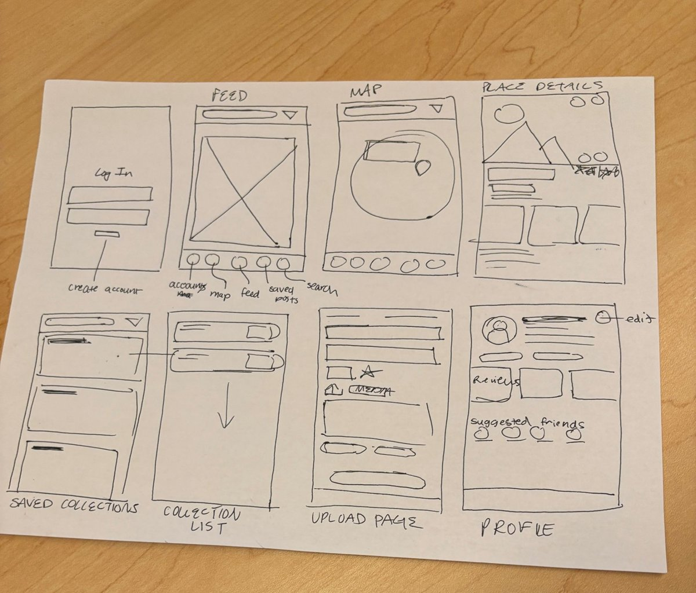
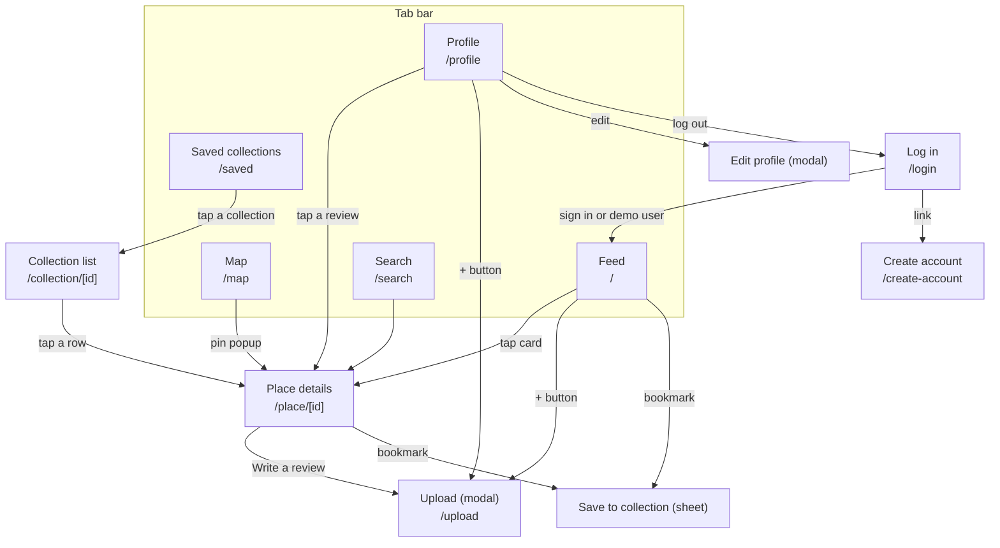

# Page plan

This folder plans each page from our low-fidelity sketch: what goes on the page, where it sits in navigation, which data and components it needs, and what's still undecided. No code yet. Each page has its own file, with its part of the sketch at the top.



| # | Page | Route | Plan |
| - | ---- | ----- | ---- |
| 1 | Log in (+ Create account) | `/login` | [01-login.md](01-login.md) |
| 2 | Feed | `/` | [02-feed.md](02-feed.md) |
| 3 | Map | `/map` | [03-map.md](03-map.md) |
| 4 | Place details | `/place/[id]` | [04-place-details.md](04-place-details.md) |
| 5 | Saved collections | `/saved` | [05-saved-collections.md](05-saved-collections.md) |
| 6 | Collection list | `/collection/[id]` | [06-collection-list.md](06-collection-list.md) |
| 7 | Upload | `/upload` | [07-upload.md](07-upload.md) |
| 8 | Profile | `/profile` | [08-profile.md](08-profile.md) |

Search is in the sketch's tab bar and already has a placeholder (`src/app/(tabs)/search.tsx`), but it isn't planned here.

## Navigation

### Route tree

Everything sits inside the root stack in `src/app/_layout.tsx`. Pages inside `(tabs)` show the tab bar. Pages outside it open on top of the tabs with a back button, which is how `place/[id]` already works.

```
Root Stack                     src/app/_layout.tsx, wrapped in a SessionProvider
├─ Signed out only
│  ├─ login                    /login
│  └─ create-account           /create-account
└─ Signed in only
   ├─ (tabs)                   tab bar, src/app/(tabs)/_layout.tsx
   │  ├─ profile               /profile            "Account" tab
   │  ├─ map                   /map
   │  ├─ index                 /                   "Feed" tab, the app opens here
   │  ├─ saved                 /saved              NEW tab
   │  └─ search                /search             (not in this plan)
   ├─ place/[id]               /place/:id          pushed, back button
   ├─ collection/[id]          /collection/:id     pushed, back button       NEW
   ├─ upload                   /upload             modal                     NEW
   ├─ save-to-collection       /save-to-collection sheet, ?placeId=...       NEW (see 05)
   └─ edit-profile             /edit-profile       modal                     NEW (see 08)
```

`save-to-collection` and `edit-profile` aren't in the sketch. The bookmark button and the edit button need somewhere to go, so they're planned inside the Saved Collections and Profile docs.

### Flow between pages



### Tab bar

The sketch's tab order, left to right: **Account (Profile), Map, Feed, Saved, Search**. The current `src/app/(tabs)/_layout.tsx` has Feed, Search, Map, Profile, so the changes are:

- Add a `saved.tsx` tab (SF Symbol `bookmark.fill`, Material `bookmark`).
- Reorder the tabs to match the sketch.
- Feed stays as `index.tsx`, so `/` is still the Feed even though it's now the middle tab. After building the login gate, check that signing in lands on Feed and not on the first tab (Profile). If it doesn't, look up how to set the initial tab in the Expo Router docs.

### Login gate

- A `SessionProvider` holds the signed-in user, and `useSession()` reads it (planned in [01-login.md](01-login.md)).
- The root layout wraps the two groups above in `Stack.Protected`. Its `guard` prop decides whether those screens exist: `guard={!user}` for login and create-account, and `guard={!!user}` for everything else. When `user` changes, the router moves to the first screen that's allowed, so signing in opens the tabs and logging out opens Login.
- `redirectTo` on `Stack.Protected` needs SDK 58, and we're on SDK 57, so put `login` first in its group.
- Once this works, delete the temporary "Go to login" link on the Profile placeholder.

## Shared pieces

These show up on several pages. Build them once.

| Piece | Where | Used by |
| ----- | ----- | ------- |
| `SearchFilterBar`: the search pill and ▽ from the sketch | new component, wraps the existing `SearchBar` | Feed, Map, Saved |
| `BookmarkButton`: filled when the place is in any collection; tapping it opens the save sheet | new component | Feed, Place details, Collection list |
| `RatingStars`: shows 0–5 stars, or lets you pick 1–5 on Upload | new component, SF Symbol `star.fill` through `expo-symbols` | Feed, Map, Place details, Upload, Profile |
| `ReviewCard`: reviewer, stars, text, photos | new component | Place details, Profile |
| `ChipList`: a row of pill-shaped tags | generalize `ProfileInterests` | Place details, Upload, Profile |
| `MediaStrip`: horizontal, swipeable photos | replaces the Previous/Next buttons in `MediaPost` | Feed, Place details, Upload |

The ▽ filter opens a small sheet with place type, suited for, and city, which match the fields on `Place`.

## Data the pages need

### Type changes

- **`Place`** (`src/types/place.ts`)
  - Add `latitude` and `longitude`. Map pins need coordinates, and `address` alone isn't enough.
  - Add `media: Media[]`. `mockPlace` already sets it, which is why `npx tsc --noEmit` currently fails.
  - Remove `bookmark` and `addToList`. Saved or not depends on who's signed in, so that lives in collections.
- **`Media`**: keep only one. Root `types.ts` has `{ imgURL, caption }` and `MediaPost` uses it, but `mockPlace` uses `{ type, url, caption }`. Use `{ type: 'photo' | 'video'; url: string; caption?: string }` in a new `src/types/media.ts`.
- **`Collection`** (new, `src/types/collection.ts`): `id`, `ownerId`, `name`, `coverImage?`, and `items: CollectionItem[]`. `CollectionItem` is either `{ kind: 'place'; placeId }` or `{ kind: 'review'; reviewId }`, the same `kind` pattern as `SearchResult`.
- **`Review`**: replace `profileName` with `authorId`, because Profile has to find a user's reviews and names aren't unique.
- **`Profile`**: add `bio?` and `friendIds: string[]` for suggested friends.
- **Root `types.ts`**: move what we keep into `src/types/`. `Post` overlaps with `Review`, and `Map` overlaps with `Place`, so decide whether to retire them (see Feed's open questions).

### Services

Each service is a copy of `src/services/template-service.ts` with mock data, so Supabase can replace the insides later.

| Service | Functions |
| ------- | --------- |
| `users.ts` | `mockUsers` (3 demo users), `getProfile(id)`, `getSuggestedFriends(userId)`, `updateProfile()` |
| `places.ts` | `getPlaces(filters?)`, `getPlace(id)`, `createPlace()` |
| `reviews.ts` | `getReviewsForPlace(placeId)`, `getReviewsByUser(userId)`, `createReview()` |
| `collections.ts` | `getCollections(userId)`, `getCollection(id)`, `createCollection(name)`, `addToCollection()`, `removeFromCollection()`, `getSavedCollectionIds(placeId)` |
| `src/hooks/use-session.tsx` | `SessionProvider` and `useSession()`, which returns `{ user, signIn, signInAsMockUser, signOut }` |

Give each mock user their own reviews, collections, and home country, so switching users during the demo visibly changes the app.

## Fix before building on existing code

- `FeedItem`, `MapPin`, and `PlaceTag` use web HTML (`<article>`, `<div>`, `<button>`, ``, `<a>`), which doesn't work on iOS or Android. Rewrite them with `View`, `Text`, `Pressable`, and `expo-image`.
- `npx tsc --noEmit` fails right now:
  - `src/components/map-pin.tsx` imports `'../types'`, which doesn't exist.
  - `mockPlace` sets a `media` field that isn't on `Place`.
- `PlaceDetails` loads its star from a long remote image URL. Use `RatingStars` instead.

## Suggested build order

1. Types, services, and mock data. Every page depends on these.
2. Session, Login with demo users, and the login gate.
3. Feed and Place details.
4. Saved collections, Collection list, and the save sheet.
5. Profile and Edit profile.
6. Upload.
7. Map. It needs a development build instead of Expo Go (see [03-map.md](03-map.md)), so one person can start a test map early alongside the rest.
